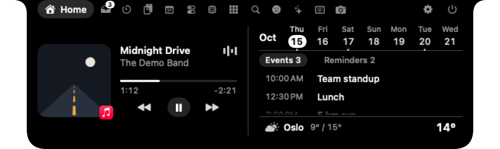
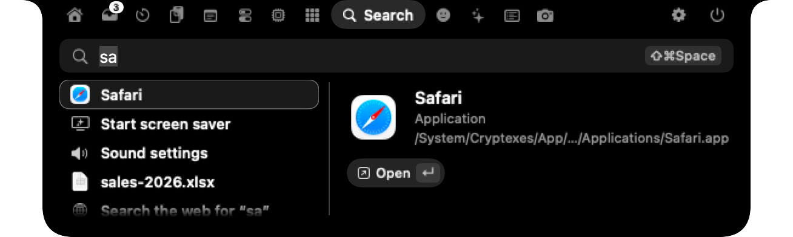
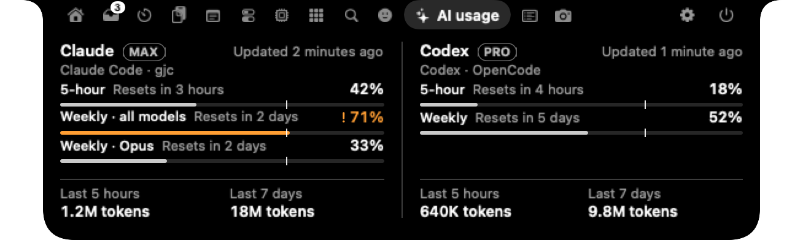
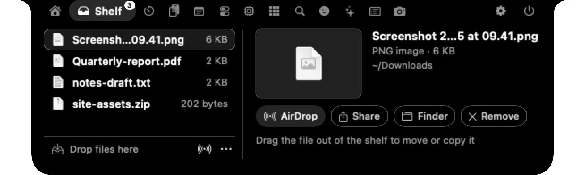
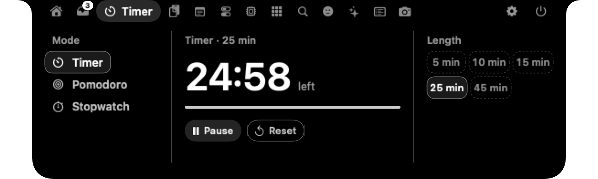
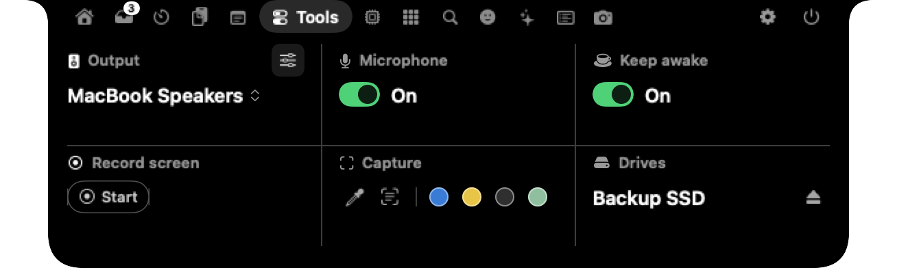
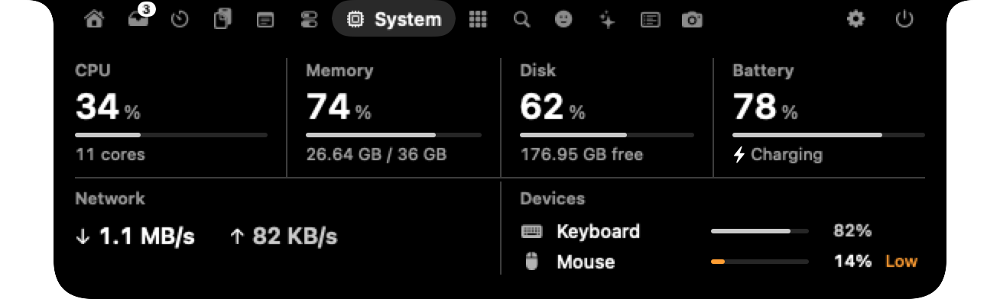
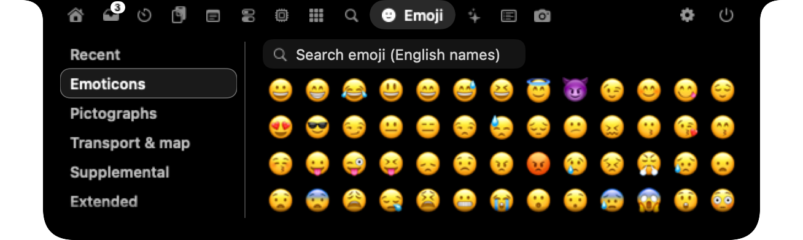

<p align="center"></p>

<h1 align="center">Nunsseop</h1>

<p align="center">
  <b>Die Notch deines MacBooks, endlich nützlich.</b><br>
  Musik, Anrufe, Dateien, ein Launcher im Spotlight-Stil, KI-Nutzung, Mitteilungen von Agenten, dein Kalender und System-HUDs, alles nur einen Hover entfernt.
</p>

<p align="center">
  <a href="https://github.com/namekun/Nunsseop/releases/latest"></a>
  
  <a href="LICENSE"></a>
  
</p>

<p align="center">
  <a href="README.md">English</a> · <a href="README.ko.md">한국어</a> · <a href="README.ja.md">日本語</a> · <a href="README.zh-Hans.md">简体中文</a> · <a href="README.es.md">Español</a> · <b>Deutsch</b> · <a href="README.fr.md">Français</a> · <a href="https://namekun.github.io/Nunsseop/">Website</a>
</p>

<p align="center">
  
</p>

*Nunsseop* (눈썹) ist Koreanisch für *Augenbraue*, den kleinen Bogen über deinem Bildschirm. Die App ist kostenlos und Open Source, ohne Account, Abo oder Tracking.

## In 30 Sekunden installieren

```sh
brew install --cask namekun/tap/nunsseop
```

Dafür brauchst du [Homebrew](https://brew.sh). Homebrew entfernt das Quarantäne-Flag, sodass sich die App sofort öffnen lässt. Zum Aktualisieren führst du `brew update && brew upgrade --cask nunsseop` aus; sobald ein Update verfügbar ist, kopiert Einstellungen › Allgemein › Updates diesen Befehl in deine Zwischenablage (bei einer App, die aus dem alten dmg installiert wurde, einen Befehl, der sie zu Homebrew umzieht).

Erfordert macOS 14 Sonoma oder neuer. Läuft auf Macs mit Apple Silicon (nicht auf Intel), auch auf Bildschirmen ohne Notch.

## Deine erste Minute

1. **Fahre mit dem Zeiger über die Notch.** Sie klappt auf. Bewegst du den Zeiger weg, zieht sie sich wieder zurück.
2. **Spiele etwas ab**, in Music, Spotify, YouTube Music oder einem beliebigen Browser. Die Notch erkennt es, und die eingeklappte Notch zeigt ein kleines Cover und einen Visualizer.
3. **Rechtsklick auf die Notch → Einstellungen**, um deine Tabs, ihre Reihenfolge, die gewünschten Pop-ups und die Größe festzulegen.

Es gibt kein Dock-Symbol. Nunsseop lebt in der Notch.

Bei einer frischen Installation öffnet sich die Notch nach einer Sekunde außerdem von selbst und führt dich in vier kurzen Schritten durch: wie sie sich öffnet und schließt, die Tabs, Dateien und Suche und das Verbinden der Agenten-Tools, die auf diesem Mac gefunden wurden (oder, wenn es keine gibt, „Alles bereit“). „Überspringen“, Esc oder „Fertig“ beendet sie, und Einstellungen › Allgemein › „Tour erneut zeigen“ spielt sie noch einmal ab. Nach einem Update öffnet sie sich einmal, zeigt, was in dieser Version neu ist, und lässt dich dann in Ruhe.

## Ein Blick ins Innere

| | |
| :---: | :---: |
| <br>**Suche.** Ein Launcher für Apps, Dateien, Befehle, Zwischenablage, Emoji und Rechenaufgaben, mit einem Kurzbefehl deiner Wahl. | <br>**KI-Nutzung.** Limits von Claude Code und Codex, ganz ohne Anmeldung. |
| <br>**Ablage.** Parke Dateien in der Notch oder wirf sie auf AirDrop. | <br>**Timer.** Countdown, Pomodoro und Stoppuhr, in jeder gewünschten Länge. |
| <br>**Werkzeuge.** Audioausgabe, Mikrofon stummschalten, Wach halten, Bildschirmaufnahme, Farbwähler und Texterfassung. | <br>**System.** CPU, Speicher, Festplatte, Netzwerk und Geräte-Akkus. |
| <br>**Emoji.** Kategorien links, alle Emoji durchsuchbar, mit einem Klick kopiert. | <br>**HUDs.** Lautstärke, Helligkeit, AirPods-Akku und mehr. |
| <br>**Anrufe.** Die Anruf-App und wie lange du schon sprichst. | <br>**Auf einen Blick.** Wähle, was jede Seite der geschlossenen Notch anzeigt. |

## Alles, was die App kann

**🎵 Musik**
- **Aktuelle Wiedergabe aus jeder App.** Music, Spotify, YouTube Music und Browser wie Safari, Chrome, Arc, Dia und Aside. Cover, Steuerung und eine Fortschrittsleiste zum Ziehen.
- **Synchronisierte Songtexte** von [LRCLIB](https://lrclib.net), unter dem Titel oder unter der Notch, während du arbeitest.
- **Vorschau.** Wechselt der Song, blendet sich kurz sein Titel ein.
- **Podcasts und lange Videos** bekommen 15-Sekunden-Sprünge und eine Geschwindigkeitstaste (1× bis 2×), sofern der Player sie unterstützt.

**🗂️ Dinge erledigen**
- **Ablage.** Ziehe Dateien auf die Notch und später wieder heraus, mit Vorschau für Bilder, PDFs und Videos, die mit der Höhe der Ablage wachsen. Bildschirmfotos und fertige Downloads können automatisch dort landen. Schüttle den Zeiger beim Ziehen von Dateien irgendwo, und direkt neben ihm erscheint ein kleines Ablageziel.
- **Kalender und Erinnerungen.** Der heutige Tag in großen Ziffern, deine Woche mit einem Punkt an vollen Tagen, die heutigen Termine und Erinnerungen zum Abhaken. Jeder in macOS hinzugefügte Account funktioniert (Google, iCloud, Exchange und mehr), und du wählst, welche Kalender angezeigt werden.
- **Anstehende Termine.** Fünf Minuten vor Beginn eines Termins mit Uhrzeit zeigt die Notch seinen Titel und wie bald er startet. Termine mit einem Link zu Zoom, Google Meet, Teams, Webex, FaceTime, Whereby oder Chime erhalten im Start-Tab eine grüne Schaltfläche „Beitreten“, und ein Klick auf die Mitteilung tritt dem Meeting bei.
- **Eine Suche, die Spotlight ersetzen kann.** Apps (auch solche außerhalb des Ordners „Programme“), Dateien, Systembefehle und Einstellungen, Zwischenablage-Verlauf, Emoji (beginne mit `:`) und Rechenaufgaben wie `12*(3+4)`, sortiert danach, was du am häufigsten öffnest. Auch Initialen funktionieren: `vsc` findet Visual Studio Code. Pfeiltasten wählen aus, der Zeilenschalter öffnet.
- **Deine Kurzbefehle.** Standardmäßig öffnet <kbd>⇧⌘Leertaste</kbd> die Suche, oder nimm dafür eine beliebige Kombination auf. Unter Einstellungen › Allgemein › Kurzbefehle gibt es außerdem Aktionen, die leer starten: zum Agenten wechseln, der am längsten wartet (sein Terminal kommt in den Vordergrund), den Agenten-Tab öffnen, zur Quelle der letzten Mitteilung wechseln und die Notch öffnen oder schließen. Eine Kombination, die eine andere Aktion schon belegt, wird nicht gespeichert, und Nunsseop sagt dir, wenn macOS oder eine andere App sie schon belegt.
- **Timer, Zwischenablage-Verlauf, Notizen und eine Emoji-Auswahl.** Der Zwischenablage-Verlauf bleibt im Speicher und überspringt alles, was ein Passwortmanager als geheim markiert. Tracking-Parameter wie `utm_` und `fbclid` werden aus kopierten Links entfernt.
- **Ein Detail neben der Liste.** Ablage, Zwischenablage, Apps, Suche und Mitteilungen zeigen das Element unter dem Zeiger (oder das mit ↑ ↓ gewählte) rechts mit seinen Aktionen. Ein Klick auf eine Zeile kopiert, öffnet oder springt wie bisher sofort zur Quelle.

**💻 Dein Mac**
- **System-HUDs.** Lautstärke, Helligkeit (auch bei externen DDC-Bildschirmen), Tastaturbeleuchtung, Ladevorgang, Feststelltaste und AirPods-Akku erscheinen in der Notch. Die App kann die Tasten für Lautstärke und Helligkeit übernehmen, damit das System-HUD ausbleibt.
- **Systemwerte und Akkus.** CPU, Speicher, Festplatte, Netzwerk und der Akku dieses Macs als Panels sowie deine Maus, Tastatur und dein Trackpad, mit einer Warnung bei niedrigem Akkustand.
- **Kamera- und Mikrofonanzeige.** Ein Punkt auf der Notch, solange eine App sie verwendet.
- **Werkzeuge.** Audioausgabe wechseln, die Lautstärke jeder App einstellen (experimentell, macOS 14.2+), das Mikrofon stummschalten, den Mac wach halten, den Bildschirm aufnehmen, Laufwerke auswerfen, eine Farbe an beliebiger Stelle des Bildschirms auswählen und den Text aus jedem Bereich des Bildschirms kopieren.
- **Wetter, Downloads, Spiegel und Dock-Apps**, nur einen Hover entfernt. Das Wetter ist eine Zeile unten im Start-Tab.

**📞 Auch wenn sie geschlossen ist**
- **Anrufe.** Bei einem Anruf in Zoom, FaceTime, Teams, Slack, Discord, WhatsApp oder Google Meet zeigt die geschlossene Notch die App und wie lange du schon sprichst. Maßgeblich ist, welche App das Mikrofon nutzt, daher braucht die Anzeige eines Anrufs in einer Desktop-App keine Berechtigung; bei Anrufen im Browser (Meet, Zoom oder Teams im Web) braucht sie Automation für diesen Browser. Bei Zoom, FaceTime und Meet kannst du das Mikrofon stummschalten (bei Zoom und Meet auch die Kamera ausschalten), direkt von der Notch aus, ohne zum Anruf zu wechseln; Zoom und FaceTime brauchen dafür Bedienungshilfen, Meet braucht in einem Chromium-Browser die Option *JavaScript von Apple Events erlauben*.
- **Deine Wahl auf jeder Seite.** Wenn nichts abgespielt wird, zeige die verbleibende Nutzung von Claude Code oder Codex, aktive Agenten, Akku, Wetter oder das Datum.
- **Musik und Timer.** Ein kleines Cover und ein Visualizer, solange Musik läuft, und die Restzeit, solange ein Timer läuft. Timer, Anrufe und Downloads passen jede Seite an ihren eigenen Inhalt an, sodass neben einem einzelnen Symbol keine Lücke bleibt.
- **Downloads.** Wie weit ein Download in Safari oder Chrome ist, in Prozent, anhand desselben Fortschritts, den der Finder an der Datei zeigt. Nichts fragt ständig nach.

**🤖 Für Entwickler**
- **KI-Nutzung.** Limits von Claude und Codex mit Zeitpunkten des Zurücksetzens sowie der Token-Verbrauch der letzten 5 Stunden und 7 Tage, gezählt über Claude Code, Codex, gjc, omo und OpenCode hinweg. Gelesen aus Dateien, die diese Tools ohnehin auf deinem Mac ablegen, daher musst du dich nirgends anmelden. Ein Limit wird ab 70 % orange und bekommt ein „!“.
- **Claude-Limits von Claude Code.** Verbinde unter Einstellungen › Dienste › KI-Nutzung die Statuszeile von Claude Code. Claude Code übergibt ihr deine 5-Stunden- und Wochenlimits bei jeder Antwort, sodass der Tab „KI-Nutzung“ aktuell bleibt, während du arbeitest, ohne dass Nunsseop dafür bei Anthropic nachfragt. Die Statuszeile, die du schon hattest, wird wie bisher angezeigt, und „Trennen“ stellt sie wieder her. Lässt sich dein bisheriger Befehl nicht wiederherstellen, weisen die Einstellungen darauf hin.
- **Claude-Limits live (optional).** Für den Fall, dass du Claude anderswo nutzt, fragt der Tab „KI-Nutzung“ einmal, ob deine 5-Stunden- und Wochenlimits von Claude etwa einmal pro Stunde bei Anthropic abgerufen werden sollen, mit der Anmeldung, die Claude Code im Schlüsselbund ablegt. Claude Code erneuert diese Anmeldung, wenn es läuft; nach einer Weile ohne es bittet der Tab daher, Claude Code zu starten, nicht sich neu anzumelden. Aus, bis du zustimmst; später änderbar unter Einstellungen › Dienste. Es gilt die jeweils aktuellste Quelle; Tarif und Balken je Modell bleiben, wenn sie diese nicht mitbringt.
- **Limit-Hinweise.** Die Notch meldet sich einmal, wenn ein 5-Stunden- oder Wochenlimit von Claude oder Codex 80 % überschreitet, und noch einmal bei 95 %, und sagt Bescheid, wenn ein so weit genutztes Limit zurückgesetzt wird. Standardmäßig an; Einstellungen → Hinweise → KI-Nutzung.
- **Mitteilungen von Agenten und Terminals.** Hooks von Claude Code, Codex, Gemini CLI, GitHub Copilot, Antigravity, Cursor und OpenCode, Erweiterungen von omp, omo und pi, Plugins von Hermes und Amp, Agenten in Muxy 2, cmux, herdr und Paseo sowie Glocken von tmux und WezTerm erscheinen in der Notch. Ein Klick auf eine Mitteilung bringt das zugehörige Terminal, den Bereich oder Tab in den Vordergrund ([Einrichtung weiter unten](#mitteilungen-von-agenten-und-terminals)).
- **Berechtigungsanfragen und Fragen.** Erlaube, lehne ab oder erlaube immer, was Claude Code ausführen oder bearbeiten will, direkt in der Notch; „Immer erlauben“ erscheint nur, wenn Claude Code eine Regel aus einfachen Tastaturzeichen (druckbares ASCII) vorschlägt, die auf die Karte passt. Die Karte zeigt das Tool, den Ordner und jedes Feld; ein oranger Chip „Ungewöhnliche Zeichen“ warnt, wenn der Text Zeichen enthält, die für englische Buchstaben oder Symbole durchgehen können. Freigaben von Codex für Befehle, Dateiänderungen (bei `apply_patch` werden die Dateien aufgelistet) und MCP-Tools laufen genauso, mit „Im Terminal antworten“ statt „Immer erlauben“. Berechtigungsanfragen von OpenCode laufen genauso, ebenso Tool-Freigaben von Paseo, dort mit „In Paseo antworten“ statt „Im Terminal antworten“. Freigaben von GitHub Copilot, Antigravity (Befehle und Dateischreibvorgänge) und Cursor (Shell-Befehle und MCP-Aufrufe) laufen genauso, bei Cursor mit „In Cursor antworten“. Lässt eine Anfrage irgendeinen Zweifel daran, was ausgeführt würde (etwa ein Shell-Befehl von Cursor außerhalb seiner Sandbox), erscheint keine Karte, und das Tool fragt in seiner eigenen Eingabeaufforderung. Gemini CLI, Hermes und Amp zeigen Sitzungen und Mitteilungen, aber keine Freigaben. Auch Fragen von Claude Code lassen sich beantworten: eine oder mehrere Antworten wählen, mehrere Fragen nacheinander durchgehen oder per „Im Terminal antworten“ ans Terminal zurückgeben; eine Frage, deren Antworten sich nicht originalgetreu zeigen lassen, bleibt im Terminal. Antwortest du zuerst im Terminal, verschwindet die Karte. Was gefragt wird, bleibt im Arbeitsspeicher (abschaltbar unter Einstellungen › Hinweise).
- **Tab „Mitteilungen“.** Die letzten 30 Mitteilungen von Agenten, Terminals und deinem Kalender, mit einem Badge für ungesehene; ein Klick führt dich dorthin zurück, woher sie kam. Standardmäßig aus (Einstellungen › Notch) und nur im Speicher gehalten.
- **Eine Braue mit Laune.** Die Braue zeigt, wie es deinen Agenten geht: hochgezogen mit erhobenem Ende, solange einer auf dich wartet, tief und gerade, während sie arbeiten. Beendet ein Agent seinen Zug, hüpft die Braue zweimal und die Notch sagt, welcher fertig ist (außer sein Terminal ist schon vorne; Einstellungen › Hinweise). Sie hängt herab, wenn ein Limit von Claude oder Codex knapp wird, und hebt sich wieder, wenn es zurückgesetzt wird. Ohne Notch trägt die Braue der App selbst die Laune; neben einer Kamera zeigt die Agentenzahl eine kleine, und Hinweise von Agenten und Limits nutzen sie als Symbol. Mit „Bewegung reduzieren“ bleibt sie still.
- **Aktive Agenten.** Ein Element der geschlossenen Notch, das anzeigt, wie viele Coding-Agenten auf dich warten (eine hochgezogene Braue, die Zahl in Gelb) oder, wenn keiner wartet, wie viele arbeiten (eine tiefe, gerade Braue, die Zahl in Grün). Claude Code, Codex, Gemini CLI, OpenCode, GitHub Copilot, Antigravity, Cursor, Hermes, Amp, omp, omo und pi werden über Hooks, Plugins oder Erweiterungen beobachtet (verbinden unter Einstellungen › Hinweise; Codex fragt beim nächsten Start, ob du den Hooks vertraust), gjc, herdr, Muxy 2 und Paseo auch ohne Verbinden, dazu Hintergrundsitzungen, die mit `claude --bg` gestartet wurden. Beendet Claude Code einen Zug, während Subagenten oder Shell-Befehle im Hintergrund noch laufen, zählt die Sitzung bis zu zwei Stunden weiter als aktiv, mit einem Chip „Hintergrund · N Aufgaben“ im Agenten-Tab.
- **Agenten-Tab.** Eine Zeile pro Coding-Agent-Sitzung, die läuft oder auf dich wartet: Claude Code, Codex, Gemini CLI, OpenCode, GitHub Copilot, Antigravity, Cursor, Hermes, Amp, omp, omo, pi, gjc, Paseo und was in herdr oder Muxy 2 läuft. Der Zustand unterscheidet sich in Form und Farbe: ein gefüllter oranger Punkt, wenn die Sitzung auf dich wartet, ein kreisender grüner Bogen, solange sie arbeitet, ein leerer Ring, wenn sie inaktiv ist. Dann folgen der Titel (der `/rename`-Name in Claude Code oder dessen eigener Titel, der Thread-Name in Codex), der Ordner, Tool und Modell, ein Chip, wenn der Berechtigungsmodus nicht der Standard ist, eine kleine Kontextanzeige mit der Token-Zahl und die Zeit seit dem Beginn des Zustands. Jede Zeile hat die Schaltflächen „Zum Terminal“ (bei Paseo-Zeilen „In Paseo öffnen“) und „Nachricht“; eine gestrichelte kann gerade nichts tun, und ihr Tooltip sagt, warum. Eine Sitzung, die auf dich wartet, klappt auf und zeigt „Im Terminal antworten“. Die Zeile unten fasst die Zustände zusammen („1 wartend · 3 aktiv · 1 inaktiv“). Tastatur: ↑↓ wählt aus, ↵ geht zum Terminal, ⌘M öffnet das Nachrichtenfeld; auch ein Doppelklick auf eine Zeile geht zu ihrem Terminal. Offene Sitzungen, die du in den letzten 3 Stunden genutzt hast, erscheinen abgedunkelt als „Inaktiv“ (die geschlossene Notch zählt sie nicht). Ist keine Sitzung offen, listet „Zuletzt“ bis zu 5 nicht geöffnete Gespräche der letzten Woche: ein Klick (oder ↵) setzt sie in dem unter Einstellungen › Hinweise gewählten Terminal fort (`claude --resume`, `codex resume` oder die eigene Option des Tools). Gelesen werden Ordner, Modell, Token-Zahl, Berechtigungsmodus, Sitzungsname und letzter Prompt aus den eigenen Sitzungsdateien der Tools auf deinem Mac. Unter einer aktiven Sitzung oder einer, die ihren Zug beendet hat, steht ihr letzter Schritt: die gelesene oder bearbeitete Datei, der ausgeführte Befehl, die gestellte Frage. Eine Bearbeitung zeigt ihr +N −M und **Diff zeigen**, das die geänderten Zeilen anstelle der Liste zeigt (← → für die anderen Änderungen des Zugs, Esc zurück). Solange der Tab eine aktive Sitzung zeigt, wird ihre Sitzungsdatei alle 2 Sekunden angesehen.
- **Einer Sitzung schreiben, Dateien auf sie ziehen.** Drücke die Schaltfläche „Nachricht“ einer Zeile (oder ⌘M): Die Zeile unten wird zu einem Feld „An“ mit dem Namen der Sitzung, Return schickt den Text an ihre Eingabe, gefolgt von Return, Esc bricht ab. Legst du Dateien aus der Ablage oder dem Finder auf einer Zeile ab, werden ihre Pfade ohne Return eingetippt; beim Ziehen aus der Ablage wechselst du zum Agenten-Tab, indem du den Zeiger über seine Schaltfläche hältst. Das geht bei Sitzungen in Ghostty, Terminal, iTerm2, WezTerm, kitty, cmux, herdr, Muxy 2 und Orca (Terminal nimmt Nachrichten an, aber keine Dateien), bei Paseo nur als Nachricht an Agenten, die nicht arbeiten (Tabelle unten, „Was wo funktioniert“). Gesendet wird nichts, solange eine Berechtigungsanfrage oder Frage offen sein könnte, an Sitzungen in tmux, zellij oder screen oder wenn Nunsseop nicht bestätigen kann, in welchem Terminal die Sitzung steckt.
- **Wochenrückblick.** Beim ersten Öffnen der Notch in einer neuen Woche (ab Montag) erscheint eine Karte „Was deine Braue letzte Woche sah“ mit dem, was deine Agenten getan haben: ihre Arbeitszeit im Vergleich zur Vorwoche, Sitzungen pro Tool, geänderte Zeilen (+/−) und Dateien, Tokens pro Tool, das Projekt, an dem sie am meisten gearbeitet haben, mit seinem Zeitanteil, die längste Sitzung und der aktivste Tag als Balken. Gerechnet wird auf diesem Mac aus den Sitzungsdateien von Claude Code und Codex, nichts wird irgendwohin gesendet; Sitzungen, die ein Programm mit dem Agent SDK gestartet hat, bleiben außen vor. **Bild sichern** schreibt ein PNG mit 1080×1920 Pixeln ohne Projektnamen in den Ordner „Downloads“. Jederzeit wieder zu öffnen im KI-Tab („Letzte Woche“). Standardmäßig an; ausschaltbar unter Einstellungen › Hinweise › KI-Nutzung.

**🧩 Mach sie zu deiner eigenen**
- Alle Tabs passen in eine Reihe der Kopfzeile, und der aktuelle Tab zeigt seinen Namen in einer Kapsel. Start, Timer, Werkzeuge, System und KI-Nutzung sind Panels mit großen Zahlen und dünnen Balken. Die Einstellungen haben eine Seitenleiste, und die Tab-Liste im Bereich Notch ist ein Raster mit zwei Spalten, das du per Ziehen neu ordnen kannst.
- Wähle deine Tabs, ordne sie per Ziehen und lege fest, ob die Kopfzeile das Datum zeigt, was die eingeklappte Notch zeigt und welche Pop-ups du bekommst. **Alles, was du ausschaltest, läuft nicht mehr.**
- Unter macOS 26 nutzen die ausgeklappte Notch und ihre Karten Liquid Glass, sodass der Hintergrund sanft durchscheint. Du kannst einstellen, wie dunkel das Glas ist, bis hin zu 100 % für eine tiefschwarze Notch, oder das Glas ganz ausschalten.
- Auf Bildschirmen ohne Notch ist die geschlossene Notch eine kleine Pille in der Menüleiste, auf Wunsch aus Glas, mit der Augenbraue als weißem Pinselstrich darauf. Die Augenbraue hebt sich, wenn der Zeiger darüber ist. Nach einer Weile ohne Nutzung (3 bis 60 Sekunden, oder nie) senkt sie sich wie ein sich schließendes Auge und blendet sich aus, und sie kommt zurück, sobald der Zeiger sie erreicht; verweilst du eine halbe Sekunde darauf, öffnet sie sich und setzt sich an den oberen Rand. Dort erscheinen HUDs, Mitteilungen, Songtexte und die Vorschau in einer Zeile, mit dem Symbol direkt neben der Pegelleiste, dem Prozentwert oder dem Text. Die Ruheanzeige macht die Pille auf jeder Seite nur so breit wie ihren Wert, direkt neben der Augenbraue, und die Augenbraue bleibt über der Kamera.
- Wähle Bildschirm, Größe und Hover-Verzögerung, starte sie bei der Anmeldung und blende die Notch aus, solange der Deckel geschlossen ist.
- Nach unten wischen zum Öffnen, nach oben zum Schließen, im Start-Tab zur Seite wischen, um Titel zu überspringen.
- Spricht English, 한국어, 日本語, 简体中文, Español, Deutsch und Français, passend zu deinem Mac.

## FAQ

<details>
<summary><b>macOS meldet, dass Nunsseop nicht geöffnet werden kann.</b></summary>

Die App ist noch nicht notarisiert, installiere sie also mit Homebrew (`brew install --cask namekun/tap/nunsseop`). Homebrew entfernt das Quarantäne-Flag, und die App öffnet sich sofort.
</details>

<details>
<summary><b>Beim Abspielen von Musik erscheint nichts.</b></summary>

Nunsseop zeigt, was macOS als „Aktuelle Wiedergabe“ führt, daher muss der Player im Kontrollzentrum auftauchen. Die meisten Apps und Browser tun das. Zur Ausweichlösung siehe [So funktioniert die Anzeige der aktuellen Wiedergabe](#so-funktioniert-die-anzeige-der-aktuellen-wiedergabe).
</details>

<details>
<summary><b>Kann die Suche Spotlight ersetzen?</b></summary>

Ja. Öffne Einstellungen → Allgemein, klicke auf den Kurzbefehl und drücke <kbd>⌘Leertaste</kbd>. Nunsseop weist darauf hin, dass Spotlight ihn belegt, und öffnet die Tastaturkurzbefehle, in denen du *Spotlight-Suche einblenden* abwählst. Die Suche öffnet sich auch, wenn ihr Tab ausgeblendet ist.
</details>

<details>
<summary><b>Es gibt zu viele Tabs.</b></summary>

Rechtsklick auf die Notch → Einstellungen → Notch, und schalte aus, was du nicht brauchst. Ausgeschaltete Funktionen laufen gar nicht mehr.
</details>

<details>
<summary><b>Mein Mac hat keine Notch.</b></summary>

Auf einem Bildschirm ohne Notch, etwa einem externen Monitor bei geschlossenem Deckel, ist die geschlossene Notch eine kleine Pille, die in der Menüleiste schwebt, mit der Augenbraue als weißem Pinselstrich darauf. Die Augenbraue hebt sich, wenn der Zeiger darüber ist, und beim Öffnen setzt sich die Notch in der üblichen Größe an den oberen Rand. HUDs, Mitteilungen, Songtexte und die Vorschau erscheinen in einer Zeile statt rund um eine Kamera. Bei Nichtbenutzung senkt sich die Augenbraue wie ein sich schließendes Auge, und die Pille blendet sich aus; schalte das ab oder ändere die Verzögerung in den Einstellungen. Bei mehreren Bildschirmen wandert die geschlossene Notch auf den Bildschirm, auf dem der Zeiger ist, sobald sie sich ganz geschlossen hat, und HUDs, Freigaben und die Vorschau erscheinen ebenfalls dort; wähle in den Einstellungen einen Bildschirm aus, damit sie an Ort und Stelle bleibt.
</details>

<details>
<summary><b>Warum zeigt die KI-Nutzung veraltete Claude-Limits?</b></summary>

Standardmäßig stammen die 5-Stunden- und Wochenwerte von Claude aus Caches, die andere Tools schreiben: das HUD von [oh-my-claudecode](https://github.com/Yeachan-Heo/oh-my-claudecode), während du Claude Code in einem Terminal nutzt, oder gjc. Die Karte zeigt, wann sie zuletzt aktualisiert wurden. Für Limits, die aktuell bleiben, verbinde die Statuszeile von Claude Code unter Einstellungen › Dienste › KI-Nutzung: Claude Code übergibt ihr deine Limits bei jeder Antwort, und deine eigene Statuszeile funktioniert weiter. Wenn du Claude anderswo nutzt, schalte stattdessen die Live-Abfrage der Claude-Limits im Tab „KI-Nutzung“ oder unter Einstellungen › Dienste ein. Es gilt die jeweils aktuellste Quelle; Tarif und Balken je Modell bleiben, wenn sie diese nicht mitbringt. Die Token-Summen sind immer live.
</details>

<details>
<summary><b>Nach einem Update zeigen die Lautstärketasten das HUD von Nunsseop nicht mehr.</b></summary>

Versionen vor 0.8.3 waren so signiert, dass macOS bei jedem Update die Berechtigung für Bedienungshilfen vergaß. Seit 0.8.3 bleibt sie erhalten. Wenn du von einer älteren Version kommst, entferne Nunsseop einmal unter Systemeinstellungen → Datenschutz & Sicherheit → Bedienungshilfen und erlaube es erneut; es wirkt ohne Neustart.
</details>

## Mitteilungen von Agenten und Terminals

Nunsseop lauscht an `127.0.0.1:47750` auf Mitteilungen von Tools auf deinem Mac. Anfragen müssen das geheime Token mitsenden, das in `~/Library/Application Support/Nunsseop/notify-token` liegt.

Öffne Einstellungen → Hinweise und drücke **Verbinden** neben Claude Code, Codex, Gemini CLI, GitHub Copilot, Antigravity, Cursor, OpenCode, Hermes, Amp, omp, omo oder pi. Es werden nur Tools aufgelistet, die du auf diesem Mac benutzt hast. Nunsseop ändert die Einstellungsdatei des jeweiligen Tools (`~/.claude/settings.json`, `~/.codex/config.toml`, `~/.codex/hooks.json`, `~/.gemini/settings.json`) oder fügt ein Plugin in `~/.config/opencode/plugins` bzw. eine kleine Erweiterung in `~/.omp/agent/extensions` hinzu (`~/.omo` und `~/.pi` entsprechend) und behält die alte Datei mit der Endung `.nunsseop-backup`. Bevor etwas geschrieben wird, zeigt ein Dialog, wie sich die Datei ändert (hinzugefügte Zeilen grün, entfernte rot, unveränderte Abschnitte eingeklappt) und welches Backup behalten wird; **Abbrechen** schreibt nichts. Wo die Datei mit anderen Tools geteilt wird (Claude Code, Codex, Gemini CLI, Antigravity und Cursor), bleiben bereits vorhandene Hooks unverändert, und **Trennen** entfernt nur die von Nunsseop. Codex erlaubt nur einen `notify`-Befehl, daher läuft ein vorhandener nach dem von Nunsseop weiter. Die Hooks für die Zahl aktiver Agenten kommen neben die Hooks anderer Tools in `~/.codex/hooks.json`; Codex fragt beim nächsten Start, ob du ihnen vertraust (mit „Review hooks“ vertraust du nur denen von Nunsseop, „Trust all and continue“ vertraut den neuen Hooks aller Tools), und führt sie bis dahin nicht aus; nach einem Update, das ihren Text ändert, fragt es erneut. Der Hook, mit dem du Freigaben in der Notch beantwortest, wird genauso bestätigt; hast du früher verbunden, fragt Codex einmal nach, prüfe ihn dann in `/hooks`. **Trennen** macht es rückgängig. Danach gestartete Sitzungen senden ihre Mitteilungen an die Notch. gjc muss nicht verbunden werden: Seine Sitzungen werden aus seinen eigenen Dateien gelesen, solange die Agentenzahl oder der Agenten-Tab sichtbar ist.

GitHub Copilot bekommt eine eigene Hook-Datei, `~/.copilot/hooks/nunsseop.json`; Antigravity (die Kommandozeile `agy`) bekommt einen Eintrag in `~/.gemini/config/hooks.json`, Cursor Einträge in `~/.cursor/hooks.json`, jeweils neben den Hooks anderer Tools. Hermes und Amp bekommen ein Plugin von Nunsseop (`~/.hermes/plugins/nunsseop`, `~/.config/amp/plugins/nunsseop.ts`). Hermes lädt ein Plugin erst, wenn du einmal `hermes plugins enable nunsseop` in einem Terminal ausführst; die Einstellungen zeigen diesen Befehl und ob Hermes das Plugin aktiviert hat. Die Plugin-API von Amp ist experimentell, daher kann ein Amp-Update sie unbrauchbar machen. Nach dem Verbinden melden Gemini CLI, GitHub Copilot, Antigravity, Cursor, Hermes und Amp ihre Sitzungen an die Agentenzahl und den Agenten-Tab und senden eine Mitteilung, wenn ein Zug endet. Freigaben von GitHub Copilot, Antigravity und Cursor erscheinen in der Notch nur, solange unter Einstellungen › Hinweise „Berechtigungsanfragen und Fragen in der Notch beantworten“ an ist.

Um Claude Code von Hand einzurichten, drücke **Claude-Code-Hook-Befehl kopieren** und füge ihn in `~/.claude/settings.json` ein:

```json
{
  "hooks": {
    "Notification": [
      { "hooks": [{ "type": "command", "command": "<paste the copied command here>" }] }
    ]
  }
}
```

Terminals und Agenten-Apps brauchen keinen Hook:

- **Muxy 2:** Agenten, die Muxy selbst erkennt, werden gelesen, solange Muxy läuft (`muxy activity list`). Sie erscheinen als Mitteilungen (nicht, solange Muxy im Vordergrund ist), und Sitzungen, die nur Muxy kennt, im Agenten-Tab, solange sie arbeiten oder warten. Muxy 1 mit Benachrichtigungsdatei und Socket wird nicht unterstützt.
- **cmux:** seine eigenen Mitteilungen, gelesen über den cmux-Befehl in der App und nicht angezeigt, solange es im Vordergrund ist.
- **herdr:** Agenten, die fertig sind oder auf Eingabe warten, in jeder Sitzung, gelesen aus dem Socket von herdr.
- **Paseo:** Agenten, die fertig werden oder fehlschlagen, gelesen aus Paseos eigenen Aufzeichnungsdateien, also auch ohne seinen Daemon. Freigabekarten und seine Ereignisse brauchen den Daemon auf diesem Mac, der ohne Passwort läuft und den Nunsseop nie startet.
- **tmux:** Glocken aus jedem Fenster. Nunsseop fügt nur dem laufenden tmux-Server einen Hook hinzu; `tmux.conf` bleibt unverändert.
- **WezTerm:** Glocken, über Zeilen, die du aus Einstellungen › Hinweise kopierst und in `~/.wezterm.lua` einfügst.

Jedes hat unter Einstellungen › Hinweise einen Schalter (bei WezTerm eine Schaltfläche, die stattdessen seine Konfigurationszeilen kopiert), der nur erscheint, wenn das Tool installiert ist. Tools, die bereits über ihren eigenen Hook verbunden sind, werden nicht doppelt angezeigt. Orca hat keine eigene Benachrichtigungsquelle: Seine Sitzungen erscheinen nur über die oben verbundenen Hooks und Erweiterungen (Claude Code, Codex, OpenCode, pi und Ähnliche), die die Bereichs-ID von Orca mitsenden.

Auch jedes Skript kann eine Mitteilung senden:

```sh
# notify-auth enthält den Authorization-Header, damit das Token nie in der Prozessliste auftaucht.
curl -X POST http://127.0.0.1:47750/notify \
  -H @"$HOME/Library/Application Support/Nunsseop/notify-auth" \
  -d '{"title": "Build", "message": "Finished in 42 s"}'
```

### Was wo funktioniert

Die Schaltflächen „Zum Terminal“ und „Nachricht“ einer Zeile sowie das Ablegen von Dateien funktionieren dort, wo Nunsseop sicher sein kann, in welchem Terminal die Sitzung steckt: Es prüft, ob der Prozess der Sitzung wirklich dort läuft. Text gelangt über die eigene Eingabe-API des Terminals hinein, nie als simulierte Tastenanschläge. Wo eine Nachricht oder ein Ablegen nicht geht, ist die Schaltfläche gestrichelt, und ihr Tooltip sagt, warum (tmux, zellij oder screen dazwischen; eine Anfrage wartet auf Antwort; mehrere Ghostty-Tabs im selben Ordner; und so weiter); „Zum Terminal“ holt dann trotzdem die Terminal-App nach vorn.

| Terminal | Zu Tab oder Bereich | Nachricht | Dateien ablegen | Aus „Zuletzt“ fortsetzen |
| --- | :---: | :---: | :---: | :---: |
| Ghostty | ✓¹ | ✓¹ | ✓¹ | ✓ |
| Terminal | ✓ | ✓ | — | ✓ |
| iTerm2 | ✓ | ✓ | ✓ | ✓ |
| WezTerm | ✓ | ✓ | ✓ | ✓ |
| kitty | ✓ | ✓ | ✓ | ✓ |
| cmux | ✓ | ✓ | ✓ | ✓ |
| herdr | ✓ | ✓ | ✓ | — |
| Muxy 2 | ✓ | ✓ | ✓ | ✓ |
| Orca | ✓ | ✓ | ✓ | ✓ |
| Paseo | ✓ | ✓ | — | ✓ |

¹ Nur Claude-Code-Sitzungen.

- **Ghostty, Terminal und iTerm2** werden per AppleScript gesteuert, daher fragt macOS für jedes einmal, ob Nunsseop es steuern darf (Systemeinstellungen › Datenschutz & Sicherheit › Automation). Ghostty verrät keiner Shell, welcher Tab es ist; Nunsseop wählt den Tab deshalb nach dem Ordner der Sitzung und dem Titel, den Claude Code dem Tab gibt. Der Wechsel zum Tab, Nachrichten und Ablegen gehen daher nur bei Claude-Code-Sitzungen, und ist nicht eindeutig, welcher Tab es ist, wird nichts gesendet. Terminal nimmt nur Text an, den es ausführt: Nachrichten ja, abgelegte Dateien nein.
- **WezTerm und kitty** werden über ihre Kommandozeilen-Tools (`wezterm cli`, `kitty @`) angesprochen. kitty braucht eingeschaltete Fernsteuerung mit einem Socket, auf dem es lauscht.
- **Muxy 2:** Um zum genauen Bereich einer Sitzung zu springen und Gespräche in einem neuen Tab fortzusetzen, lade einmal die kleine Brücken-Erweiterung von Nunsseop: Öffne in Muxy Settings › Extensions › Load Unpacked…, wähle `~/Library/Application Support/Nunsseop/muxy-bridge` (Einstellungen › Hinweise › „Erweiterung im Finder zeigen“ öffnet den Ordner) und schalte die Erweiterung ein. Ohne sie wählt ein Klick nur das Projekt der Sitzung aus. Sitzungen, die nur Muxy kennt (ohne Hook), kannst du ansteuern, aber nicht beschreiben.
- **Orca:** über die Kommandozeile `orca`; zuletzt genutzte Gespräche werden, solange Orca ein Fenster hat, in einem neuen Tab des Worktrees fortgesetzt, der sie enthält.
- **Paseo:** Nachrichten gehen über `paseo send` und nur an Agenten, die nicht arbeiten (auch fertige und solche, bei denen du dran bist; einen arbeitenden würde es unterbrechen); ein Klick öffnet den Agenten in Paseo (das meint die erste Spalte der Tabelle), und archivierte Agenten kommen über „Zuletzt“ zurück.
- **Fortsetzen** geschieht in dem Terminal, das unter Einstellungen › Hinweise bei „Gespräche fortsetzen in“ gewählt ist; Terminal springt ein. Ghostty, iTerm2 und cmux stehen zur Wahl, wenn sie installiert sind, und werden gestartet, falls sie nicht laufen. WezTerm steht zur Wahl, wenn sein Kommandozeilen-Tool da ist; kitty nur, solange ein Socket existiert, den eine seiner Sitzungen gemeldet hat; Orca nur, solange es mit einem Fenster läuft, und nur für Ordner, die Orca als Worktree kennt (sonst übernimmt das nächste Terminal); Muxy nur, solange seine Brücke läuft. Ghostty und iTerm2 öffnen per Automation einen neuen Tab (Ghostty ohne Berechtigung ein neues Fenster), cmux einen neuen Workspace statt eines Tabs. Die Einträge von Paseo unter „Zuletzt“ ignorieren die Einstellung und öffnen sich in Paseo.

## Berechtigungen

Nunsseop bittet um die meisten Berechtigungen erst, wenn du die Funktion zum ersten Mal nutzt, die sie braucht. Ausnahme sind der Ordner, den es auf Screenshots beobachtet (standardmäßig der Schreibtisch, sonst der eingestellte Screenshot-Ordner), und Downloads: danach kann macOS beim ersten Start von Nunsseop fragen.

| Funktion | Berechtigung | Wann gefragt wird |
| --- | --- | --- |
| Kalender | Kalender | Wenn du im Start-Tab auf *Zugriff erlauben* drückst |
| Erinnerungen | Erinnerungen | Wenn du im Start-Tab auf *Erinnerungen erlauben* drückst |
| Spiegel | Kamera | Wenn du im Spiegel-Tab auf *Kamera erlauben* drückst |
| Bildschirmaufnahme und Text aus Fenstern anderer Apps kopieren | Bildschirmaufnahme | Beim ersten Start einer Aufnahme oder Texterfassung |
| Aufnahme mit Ton | Mikrofon | Beim ersten Aufnehmen mit eingeschaltetem Mikrofonton |
| Übernahme der Tasten für Lautstärke, Helligkeit und Tastaturbeleuchtung | Bedienungshilfen | Wenn du die Option in den Einstellungen einschaltest |
| Ausweichlösung für die aktuelle Wiedergabe bei Music, Spotify und Browsern | Automation | Nur wenn die MediaRemote-Hilfsbibliothek nicht verfügbar ist |
| Google-Meet-, Zoom- und Teams-Anrufe im Browser anzeigen, Stumm- und Kamera-Tasten für Meet | Automation (dieser Browser) | Wenn ein Browser zum ersten Mal das Mikrofon nutzt |
| Neue Screenshots zur Ablage hinzufügen, Download-Hinweise | Ordner Schreibtisch und Downloads | Beim ersten Start von Nunsseop kann macOS fragen (es beobachtet den Screenshot-Ordner, standardmäßig der Schreibtisch, und den Downloads-Ordner) |
| Lautstärke pro App | Systemaudio-Aufnahme | Wenn du im Tab „Werkzeuge“ zum ersten Mal die Lautstärke einer App senkst |
| Stummtaste bei Zoom- und FaceTime-Anrufen, Kamera-Taste bei Zoom | Bedienungshilfen | Wird nie von selbst angefragt: Die Tasten erscheinen, sobald Nunsseop unter Bedienungshilfen erlaubt ist (etwa über die Option für die Lautstärketasten oben) |
| Nachrichten in Agenten-Sitzungen tippen, zum Tab einer Sitzung wechseln, Gespräche in einem neuen Tab fortsetzen (nur iTerm2 und Ghostty) | Automation (Terminal, iTerm2, Ghostty) | Beim ersten Mal in der jeweiligen App; bei Ghostty auch, sobald der Agenten-Tab zum ersten Mal eine darin laufende Sitzung auflistet |
| Bei der Anmeldung öffnen | Anmeldeobjekte | Wenn du es in den Einstellungen einschaltest |

## Datenschutz

Nunsseop sammelt und sendet keine persönlichen Daten. Es geht nur für Folgendes online:

- einmal täglich bei `api.github.com` nach einer neueren Version fragen (abschaltbar);
- synchronisierte Songtexte auf `lrclib.net` nachschlagen (abschaltbar);
- das Wetter von `open-meteo.com` für die von dir eingegebene Stadt abrufen (aus, bis du eine eingibst), wobei Apples Geocoder nach dem Standort der Stadt gefragt wird, wenn Open-Meteo sie nicht findet;
- Cover per HTTPS von bekannten Musikdiensten laden, nur wenn die MediaRemote-Hilfsbibliothek nicht verfügbar ist;
- bei `api.anthropic.com` etwa einmal pro Stunde deine Claude-Limits abfragen, mit der Anmeldung von Claude Code aus dem Schlüsselbund, nur wenn du die Live-Abfrage der Claude-Limits einschaltest.

Alles andere bleibt auf deinem Mac. Der Mitteilungsserver nimmt nur Verbindungen von diesem Mac an. Die KI-Nutzung wird aus lokalen Dateien gelesen, auch aus den Limits, die die Statuszeile von Claude Code auf diesem Mac ablegt, solange du die Live-Abfrage der Claude-Limits nicht einschaltest. Mitteilungen im Tab „Mitteilungen“ werden nur im Speicher gehalten. Aufnahmen werden neben deinen Bildschirmfotos gesichert. Die Kameravorschau läuft nur, solange der Spiegel-Tab geöffnet ist, und wird nie aufgezeichnet. Der Zwischenablage-Verlauf wird geleert, wenn Nunsseop beendet wird.

## So funktioniert die Anzeige der aktuellen Wiedergabe

Seit macOS 15.4 antwortet das private MediaRemote-Framework nur noch Prozessen, die von Apple signiert sind. Nunsseop liefert eine kleine Hilfsbibliothek (`Sources/NowPlayingHelper`) mit, die innerhalb von `/usr/bin/perl` des Systems läuft, den Zustand der aktuellen Wiedergabe liest, Befehle für Wiedergabe, Pause, Überspringen und Spulen sendet und JSON-Zeilen an die App zurückstreamt.

Das beruht auf einer privaten API, daher kann ein künftiges macOS-Update sie unbrauchbar machen. In dem Fall weicht Nunsseop für Music und Spotify auf AppleScript aus und liest bei Browsern Medien-Tabs aus. Diese Ausweichlösung braucht in jedem Browser die eingeschaltete Option *JavaScript von Apple Events erlauben*. Dia hat dafür keinen Menüpunkt, deshalb bietet Nunsseop an, es mit `--enable-applescript-javascript` neu zu starten.

## Aus dem Quellcode bauen

```sh
git clone https://github.com/namekun/Nunsseop.git
cd Nunsseop
./scripts/bundle.sh release      # build/Nunsseop.app
./scripts/make-dmg.sh            # build/Nunsseop-<version>.dmg
```

Du brauchst die Xcode Command Line Tools mit Swift 5.10 oder neuer. `scripts/bundle.sh` baut das Swift-Paket und verpackt es in ein ad-hoc signiertes App-Bundle.

## Lizenz

[MIT](LICENSE). Issues und Pull Requests sind willkommen.
